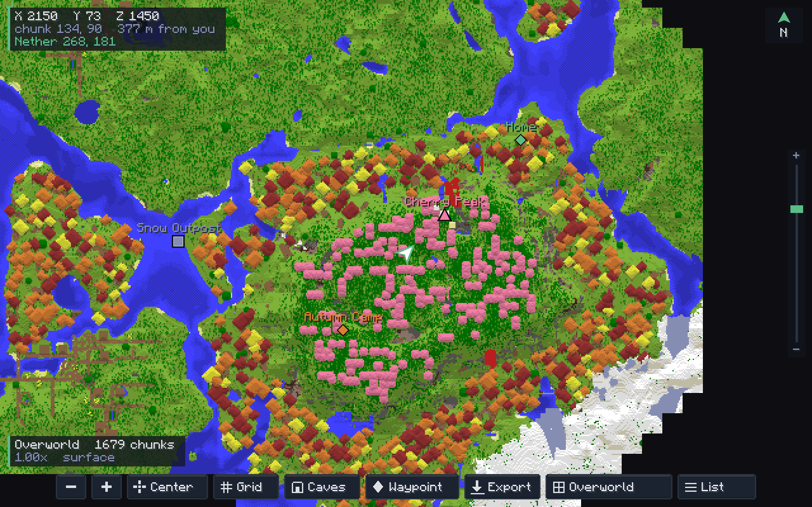
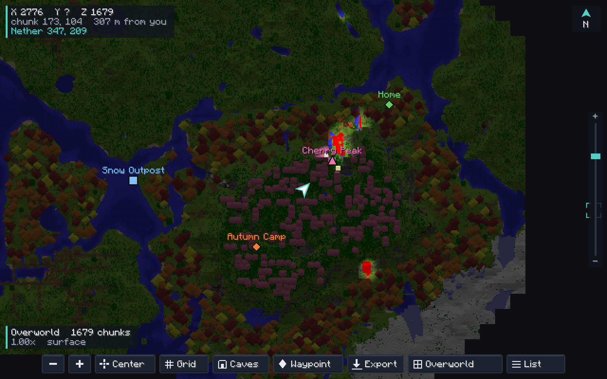
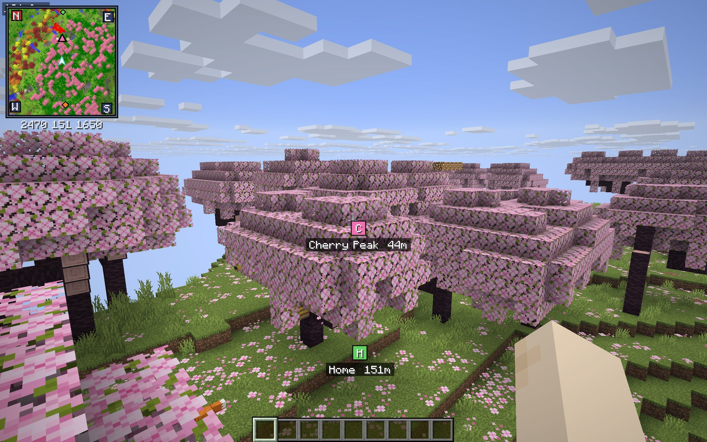
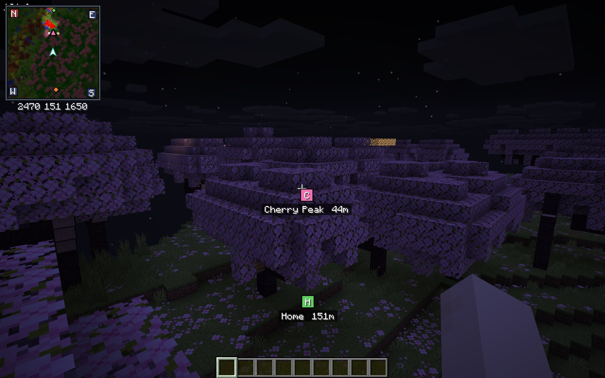
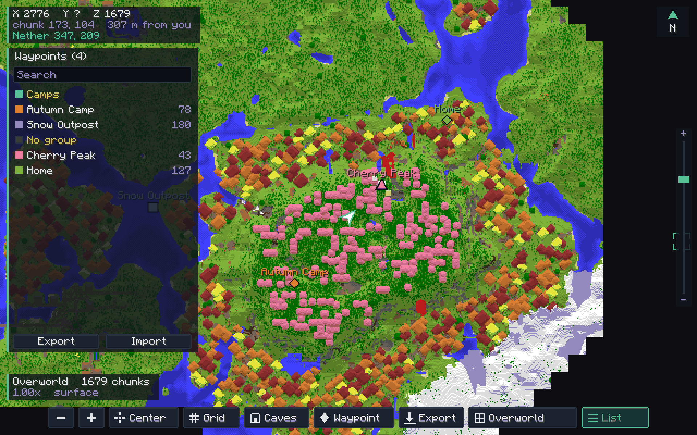
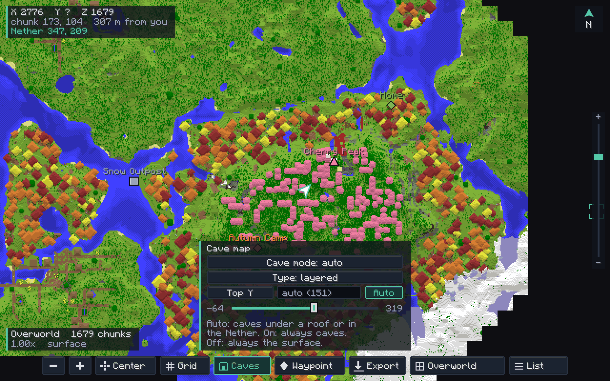

# World Map for Horizon

A full screen map that writes itself as you explore, for [Horizon](https://playhorizon.dev)
(Minecraft Java Edition 26.3, rewritten in Rust). A native mod.

> [Русская версия ниже](#world-map-для-horizon)

## Screenshots

## Features

- **Self-writing map.** The terrain you have seen stays on the map after you leave, kept
  per world, dimension and cave layer, in the vanilla map colours.
- **Smooth.** Drag to move, scroll to zoom towards the pointer. Moving the map draws
  nothing again; far zoom blurs instead of flickering.
- **Cave layers.** Under a roof, in a cave or in the Nether the map shows the floor round
  you. *Layered* keeps a map for each 16 blocks of height, *full* one for every height; a
  *Top Y* slider (-64 to 319) sets the highest block shown.
- **Waypoints.** Right-click for a menu: add, rename, 16 colours, three shapes, teleport
  (`/tp`), delete. Waypoints are drawn in the world with their name and distance, and one
  is made where you die.
- **Dimensions.** One button shows the Overworld, the Nether or the End from any of them,
  with the other world's coordinates of the place under the pointer (Nether = Overworld / 8).
- **Day and night.** The surface of the Overworld gets dark at night, as the sky does, and
  lit blocks (torches, lava, lanterns, glowstone) keep their light on the map. Off in the
  mod's settings.
- **Minimap** in a corner of the game: the map round you, turning with you (the way you face is
  up, with the sides of the world on its edge; or north up), your waypoints (those off it on
  its edge), your place, dark at night like the map. Under a roof or in a cave it shows the
  floor at your height. Other players are dots on it, bright at your height and dim above
  or below it. Its corner and size are in Options > Mods; `N` shows or hides it,
  `Z` changes its scale. Waypoints in the world are a square of their colour with a letter.
- **Waypoint list** with search, nearest first, and **groups**: give a waypoint a group in
  its menu, then click the group's heading in the list to hide or show all of them.
  **Export** and **Import** (the list's buttons) write and read `exports/waypoints.txt` and
  `exports/import.txt` in the map's folder; the import also reads the waypoints file of
  other map mods.
- **Smooth:** the map keeps gliding when you let go of a drag.
- **Also:** the biome under the pointer, other players on the map, go to coordinates, a chunk
  grid, your trail, chunks the game has loaded but the map has not read yet pulse, and the
  whole map exports as a PNG. Switches for the trail, the in-world markers, the death waypoint,
  other players and day and night are on the mod's page in Options > Mods.
- **Russian** interface when the game is in Russian.
- **Keys** are in Options > Controls > Key Binds, under *World Map*, with Reset.

## Keys

| Key | Does |
|---|---|
| M | open or close the map |
| B | new waypoint at the pointer |
| C | cave settings |
| G | chunk grid |
| H | hide or show waypoints |
| J | go to coordinates |
| L | waypoint list |
| N | minimap on or off |
| Z | minimap scale |
| Space | centre on you |
| `=` / `-` | zoom |
| Page Up / Page Down | cave map top, 16 blocks |
| Arrows or WASD | move |

All of these can be rebound.

## Install

Use the launcher: *Add from GitHub* with this repository's link (or, once it is listed, Mods,
then **Horizon**, search *World Map*). Native mods run with your rights: the launcher asks you to trust it and
builds Horizon with the mod (a few minutes the first time).

Made for Horizon Nightly `66f3981f522b24c250b21523a70080965b940424` (Minecraft 26.3). On
another revision the launcher offers *Build anyway*; it may not build there.

## Files

`config/worldmap/<world>/` in the game folder: `<dimension>/r.X.Z.bin` (explored chunks of
the surface, 32 x 32 chunks a file), `<dimension>/c.<layer>.X.Z.bin` (cave layers) and
`waypoints.txt` (one waypoint a line, tab separated). A single player world is kept under
its name (`sp-<name>`), a server under its address (`mp-<address>`). Exports go to
`exports/` beside them.

## Build from source

`mod/` is a Horizon native mod bundle (`horizon-mixin.toml` and Rust helpers). Pack it:

    python tools/pack.py        # dist/worldmap-<version>.hnmod

and install the `.hnmod`, or `horizon-launcher native-build mod --instance <name> --trust-native-code`.

## How it works

Hooks: a module added to the minimap's file (`core.rs`) reuses its column scan and map
colours to keep the explored map; a module in `game.rs` (`runtime.rs`) holds the screen, the
waypoints and the markers; the mod screen (`native_mod_screen_open`) and image
(`native_mod_image`) of Horizon draw it. `keybinds.rs`, `keyclamp.rs`, `keyenter.rs` and
`keystate.rs` add the mod's rows to the Key Binds screen.

## Credits and licence

MIT, see [LICENSE](LICENSE). Built on [Horizon](https://github.com/horizon-rust/horizon) (MIT)
and [horizon-mixins](https://github.com/horizon-rust/horizon-mixins) (MIT). Not affiliated
with Mojang, Microsoft or the authors of other map mods. No code, texture or text of any
other map mod is used here; the interface and the file formats are this mod's own.

---

# World Map для Horizon

Полноэкранная карта, которая рисуется сама по мере исследования, для
[Horizon](https://playhorizon.dev) (Minecraft Java Edition 26.3 на Rust). Нативный мод.

## Возможности

- **Карта запоминает мир.** Увиденная местность остаётся на карте после выхода: отдельно для
  каждого мира, измерения и пещерного слоя, в цветах обычных карт Minecraft.
- **Плавно.** Перетаскивайте карту мышью, колесо приближает к курсору. При перемещении
  картинка не пересчитывается, а далёкий масштаб размывается, а не мерцает.
- **Пещерные слои.** Под крышей, в пещере и в Незере карта показывает пол вокруг вас.
  Режим *layered* хранит карту для каждых 16 блоков высоты, *full* одну на все высоты,
  ползунок *Top Y* (от -64 до 319) задаёт верхний показываемый блок.
- **Метки.** Правый клик открывает меню: создать, переименовать, 16 цветов, три формы,
  телепорт (`/tp`), удалить. Метки видны в мире с названием и расстоянием, а на месте смерти
  метка появляется сама.
- **Измерения.** Одна кнопка показывает Верхний мир, Незер или Энд из любого из них, с
  координатами другого мира для точки под курсором (Незер = Верхний мир / 8).
- **День и ночь.** Поверхность Верхнего мира ночью темнеет вместе с небом, а светящиеся
  блоки (факелы, лава, фонари, светокамень) остаются яркими. Отключается в настройках мода.
- **Миникарта** в углу игры: карта вокруг вас, поворачивается за взглядом (куда смотрите,
  там верх; по краям стороны света; или север сверху), метки (те, что за её краем, на краю),
  ваше место; ночью темнеет, как карта. Под крышей и в пещере показывает пол на вашей
  высоте. Другие игроки это точки: яркие на вашей высоте, тусклые выше и ниже. Угол и размер
  в Настройки > Моды; `N` показывает и прячет её, `Z` меняет масштаб.
  Метки в мире это квадрат цвета метки с буквой.
- **Список меток** с поиском, ближайшие первыми, и **группы**: задайте метке группу в её
  меню, затем нажмите на заголовок группы в списке, чтобы скрыть или показать их все.
  Кнопки **Export** и **Import** пишут и читают `exports/waypoints.txt` и `exports/import.txt`
  в папке карты; импорт читает и файл меток других карт.
- **Плавно:** карта продолжает скользить, когда отпускаешь её после перетаскивания.
- **Ещё:** биом под курсором, другие игроки на карте, переход к координатам, сетка чанков,
  след игрока, подсветка чанков, которые игра загрузила, а карта ещё не прочитала, и экспорт
  всей карты в PNG. Переключатели следа, меток в мире, метки смерти, игроков и дня с ночью на странице мода
  в Настройки > Моды.
- **Русский** интерфейс, когда игра на русском.
- **Клавиши** в Настройки > Управление > Назначение клавиш, раздел *World Map*, со сбросом.

## Установка

Лаунчер: *Add from GitHub* со ссылкой на этот репозиторий (когда мод попадёт в реестр, ещё
Моды, затем **Horizon**, поиск *World Map*). Нативные моды работают с вашими правами: лаунчер просит довериться моду и
собирает Horizon вместе с ним (в первый раз несколько минут).

Мод сделан для Horizon Nightly `66f3981f522b24c250b21523a70080965b940424` (Minecraft 26.3).
На другой версии лаунчер предложит *Build anyway*, но сборка может не пройти.

## Файлы и лицензия

Карты лежат в `config/worldmap/<мир>/` в папке игры. Одиночный мир хранится под своим
названием, сервер под своим адресом. Лицензия MIT, см. [LICENSE](LICENSE). Мод построен на
Horizon (MIT) и horizon-mixins (MIT) и не связан с Mojang, Microsoft и авторами других
карт. Кода, текстур и текстов других модов карты здесь нет: интерфейс и форматы файлов
свои.
